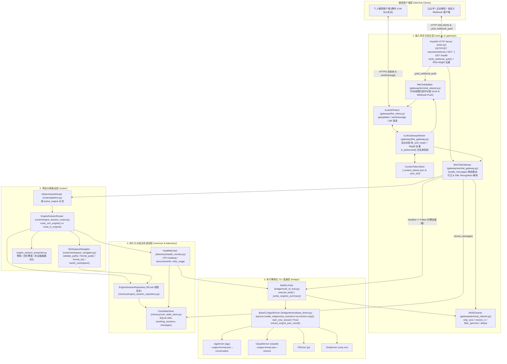
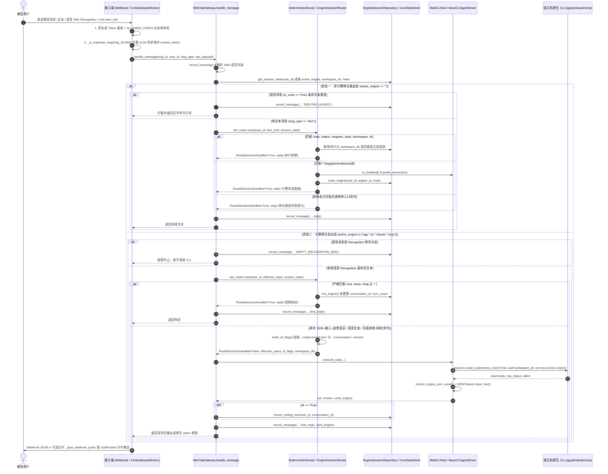

# agyWechat — 移动端随身编程的“两态分离”微信路由与四引擎原生 AI CLI 网关

[简体中文](README.md) | [English](docs/README_EN.md)


-003B57?logo=sqlite&logoColor=white)


**agyWechat** 是一个运行在本地 Linux / WSL 宿主机上的极简微信控制网关：通过**微信（个人微信腾讯 iLink Bot 扫码直连 或 公众号/企业微信 Webhook）**，直接无损桥接宿主机本地的四大原生 AI 编程 CLI 引擎——**Google Antigravity (`agy`)**、**Pi (`pi`)**、**Claude Code (`claude`)** 与 **Oh-My-Pi (`omp`)**，让你在手机微信里即可安全切换工作目录、观测宿主机硬件状态，并直接驱动本地 AI 智能体完成真实的读写文件、终端执行与多轮工程开发。

---

## 目录

- [1. 为什么开发这个项目（Motivation）](#1-为什么开发这个项目motivation)
- [2. 核心特性（Verified Features）](#2-核心特性verified-features)
- [3. 整体架构体系（Architecture）](#3-整体架构体系architecture)
- [4. 端到端快速启动指南（Quick Start & Deployment）](#4-端到端快速启动指南quick-start--deployment)
- [5. 微信端联动与互动指南（WeChat Integration）](#5-微信端联动与互动指南wechat-integration)
- [6. 微信端完整命令手册（Command Reference）](#6-微信端完整命令手册command-reference)
- [7. 常见问题排查（Troubleshooting / FAQ）](#7-常见问题排查troubleshooting--faq)
- [8. 规划路线图与开源协议（Roadmap & License）](#8-规划路线图与开源协议roadmap--license)

---

## 1. 为什么开发这个项目（Motivation）

> **开发初衷：方便用户直接在移动端进行编程。**

当人不在电脑旁、只有手机在手边时，传统远程编程方式往往体验割裂：
- **手机 SSH 终端操作繁琐**：小屏幕敲命令、切目录、处理 TUI 闪烁与 ANSI 颜色控制符极为痛苦；
- **普通微信 AI 机器人只能聊天不能改代码**：只能做云端问答，无法访问宿主机真实仓库、Git 历史、本地测试环境与本地 API 凭证；
- **过重的中介层网关破坏原生 CLI 能力**：很多自研桥接器会拦截原生 `/斜杠命令`、剥离环境变量、限制上下文或强行截断报错，导致原生 AI 编程工具（如 `agy`、`claude`、`pi`、`omp`）的原生会话与多智能体能力大打折扣。

因此，**agyWechat** 采用极简且边界明确的**“两态分离（Two-State Separation）”**架构：
- **未进入引擎时（网关路由态）**：只开放轻量的纯文本运维与导航指令（查硬件状态、查已装引擎、浏览并切换工作目录、禁止语音误触发），确保手机端安全可控；
- **进入引擎后（原生自治态）**：网关只保留 `/exit`、`/clear`、`/help` 三个控制命令，**其余 100% 的自然语言、微信原生语音转写文本与任意其他 `/斜杠命令` 均携带宿主机完整环境变量直通原生 CLI 子进程**，既能随时用手机微信指挥本地编码与排障，又能完整保留原生工具链与多轮线程记忆。

---

## 2. 核心特性（Verified Features）

以下能力均经过当前仓库实际代码与自动化测试套件验证：

- **纯粹“两态分离”有限状态机 (`DeterministicRouter` / `EngineSessionRouter`)**
  - **第一态（非引擎网关路由态）**：仅响应受控文本命令；任何语音消息与非白名单文本均被安全拦截。
  - **第二态（引擎原生自治态）**：仅截取 `/exit`、`/clear`、`/help` 三个网关控制指令，其余所有输入直接透传至当前选定的原生 CLI 子进程。
- **双通道微信接入（个人微信 iLink Bot + 标准 Webhook）**
  - **腾讯 iLink Bot 长轮询通道**：内置 `scripts/login_wechat.py` 终端二维码扫码绑定、`ILinkGatewayWorker` 异步长轮询拉取、`ContextTokenStore` 磁盘持久化（`.context_tokens.json` / `.context_tokens.sync_buf`），以及遇到 `-14` / `-2` 过期会话码时自动剥离 `context_token` 重试。
  - **Webhook HTTP 通道**：提供 `GET /wechat/webhook`（echostr 握手）与 `POST /wechat/webhook`（兼容微信官方 XML、带 `<?xml ...?>` 声明头的 XML 与结构化 JSON），支持 SHA-1 签名校验或 `X-WeChat-Token` 静态密钥校验，以及 `WECHAT_PUSH_URL` 异步推送回调。
- **严格的两态语音边界守卫 (`WeChatGateway`)**
  - **外层禁语音**：未进入引擎前收到 `msg_type == "voice"` 直接拒绝并返回提示，防止误触 AI 执行。
  - **内层原生语音直通**：进入引擎后，直接提取微信原生 `<Recognition>` 或 iLink `voice_item` 转写文本原样送入 CLI（并在回复顶部附带识别原文回显）；若微信未返回转写结果则明确报错中止，绝不伪造兜底内容。
- **四大原生 CLI 引擎 100% 环境直通与进程组隔离 (`MultiCLIHub` / `BaseCLIAgentDriver`)**
  - 支持 **`agy`**（`--output-format json` + `--conversation`）、**`claude`**（`--output-format json` + `--resume` + `--max-turns`）、**`pi`**、**`omp`** 四大引擎。
  - 通过 `asyncio.create_subprocess_exec(..., stdin=DEVNULL, env=os.environ.copy(), start_new_session=True)` 原生拉起子进程，完整继承宿主机环境变量、API Key 与 Git 凭证；超时或协程取消时使用 `os.killpg` 彻底回收子进程组。
  - 非零退出码及 `stderr` 原生报错不拦截、不限流、不熔断，经 ANSI 清洗后直接回传微信。
- **沙箱化工作区导航与宿主机硬件遥测 (`WorkspaceNavigator` / `HealthMonitor`)**
  - `/pwd`、`/ls`、`/workspace <路径>` 支持项目标识识别（`.git`、`pyproject.toml`、`package.json`、`Cargo.toml`、`go.mod`、`AGENTS.md`），并拦截系统目录（`/`、`/etc`、`/usr`、`/bin`、`/sbin`、`/var`、`/boot`、`/dev`、`/proc`、`/sys`、`/root`）及敏感凭据目录（`.ssh`、`.aws`、`.gnupg`、`.kube`、`.docker`、`gcloud`）。
  - `/status` 实时采集宿主机 CPU 1/5/15m 负载、`/proc/meminfo` 物理内存使用率、工作区磁盘空间、网关运行时长与数据库落库统计；`/engines` 并发探测四引擎安装状态、可执行路径与 `--version`。
- **终端输出清洗与代码块保护分段 (`ANSICleaner` / `WeChatSplitter`)**
  - 自动剥离 ANSI CSI/OSC 控制码、折叠 `\r` 原地刷新进度行、过滤 Braille Spinner 字符并去重连续重复状态行（同时保留 Markdown 代码块原貌）。
  - 在 **iLink 推送** 与 **Webhook 主动推送** 两条出口通道统一启用 `WeChatSplitter`，按 `WECHAT_MAX_MSG_LEN` 自动切分超长输出并在跨段处自动闭合与续接 ` ```lang ` 代码围栏。
- **双表 SQLite WAL 自净持久化 (`CoreStateStore` / `EngineSessionRepository`)**
  - 使用自关闭连接封装 `ClosingConnection` 防止文件描述符泄漏；严格维护 `working_sessions` 与 `messages` 两张表，初始化时自动清理历史废表/触发器并执行 `VACUUM`；使用 `RLock` 保护并发会话状态更新，避免多任务并发下丢失 `turn_count`。

---

## 3. 整体架构体系（Architecture）

### 3.1 系统整体架构图



### 3.2 端到端核心时序图



### 3.3 核心目录与文件职责

```text
agyWechat/
├── main.py                              # FastAPI 入口：flock 锁、Webhook 鉴权、MsgId 去重、/、/health、/wechat/webhook、iLink 生命周期
├── config.py                            # 配置加载：Pydantic Settings (.env) > config.yaml > 默认值
├── config.yaml                          # 默认系统参数与四大引擎 (agy/pi/claude/omp) 配置模板
├── run.sh                               # 前台一键启动脚本
├── requirements.txt                     # Python 运行与测试依赖清单
├── .env.example                         # 环境变量安全模板
├── deploy/systemd/
│   └── agy-wechat.service.example       # systemd 守护进程配置模板
├── gateway/                             # 微信双通道接入与输出清洗
│   ├── wechat_gateway.py                # 两态语音/文本边界守卫、XML <Recognition> 提取与直通分发
│   ├── ilink_client.py                  # 腾讯 iLink Bot HTTP 协议底层客户端
│   ├── ilink_gateway.py                 # ContextTokenStore、ILinkPusher 分片推送、ILinkGatewayWorker 长轮询
│   └── terminal_cleaner.py              # ANSICleaner（ANSI/CR/Spinner/重复行清洗）与 WeChatSplitter（代码块保护分段）
├── router/                              # 两态分离状态机路由层
│   ├── pipeline.py                      # DeterministicRouter（外层路由态 <-> 内层引擎态分流）
│   ├── engine_session_router.py         # EngineSessionRouter（外层运维与导航 + 内层严格保留 /exit /clear /help）
│   ├── engine_session_presenter.py      # 帮助文案、四引擎清单、欢迎面板与引擎内帮助格式化
│   └── workspace_navigator.py           # 安全沙箱校验与 /pwd、/ls、/workspace 目录切换
├── bridge/                              # 原生 CLI 子进程直通驱动层
│   ├── multi_cli_hub.py                 # 四引擎驱动管理、版本探测、无拦截直通调度
│   └── drivers/
│       ├── base_driver.py               # BaseCLIAgentDriver（完整宿主 env 继承、进程组隔离回收、JSON 结果解析）
│       ├── agy_driver.py                # Google Antigravity CLI 驱动（--output-format json & --conversation）
│       ├── claude_driver.py             # Claude Code CLI 驱动（--output-format json & --resume & --max-turns）
│       ├── pi_driver.py                 # Pi CLI 驱动
│       └── omp_driver.py                # Oh-My-Pi CLI 驱动
├── memory/                              # SQLite WAL 持久化层（严格双表）
│   ├── sqlite_utils.py                  # ClosingConnection 自关闭 WAL 连接器
│   ├── core_state_store.py              # CoreStateStore（working_sessions、messages 双表初始化与自动瘦身）
│   └── engine_session_repository.py     # EngineSessionRepository（线程安全读写 active_engine、workspace_dir 与会话元数据）
├── telemetry/                           # 宿主机系统遥测
│   └── health_monitor.py                # CPU loadavg、/proc/meminfo 内存、磁盘空间、运行时长与调用统计
├── scripts/                             # 运维与微信登录脚本
│   ├── login_wechat.py                  # 个人微信 iLink Bot 终端扫码登录工具
│   └── wsl_service.sh                   # 含自动拉起监控的后台服务启停管理脚本
├── docs/                                # 补充架构文档与英文版 README
└── tests/                               # Pytest 自动化测试套件
```

---

## 4. 端到端快速启动指南（Quick Start & Deployment）

### 4.1 环境依赖

- **操作系统**：Linux 或 Windows WSL2（宿主机硬件内存采集依赖 `/proc/meminfo`；非 Linux 环境可降级显示 `N/A`）
- **Python**：Python `3.10+`（实测于 Python `3.12.3`）
- **SQLite**：系统内置 SQLite `3.35+`（需支持 `ALTER TABLE ... DROP COLUMN` 自动迁移）
- **至少安装以下任意一个原生 AI CLI 引擎**（需已在宿主机完成鉴权登录且加入 `PATH` 或通过 `.env` 指定路径）：
  - `agy` (Google Antigravity CLI)
  - `pi` (Pi Coding Agent CLI)
  - `claude` (Claude Code CLI)
  - `omp` (Oh-My-Pi CLI)

### 4.2 安装步骤

```bash
# 1. 克隆仓库
git clone https://github.com/MartinWZX/agyWechat.git
cd agyWechat

# 2. 创建虚拟环境并安装 Python 依赖
python3 -m venv venv
./venv/bin/pip install --upgrade pip
./venv/bin/pip install -r requirements.txt

# 3. 复制环境变量模板
cp .env.example .env
```

### 4.3 配置说明

配置加载优先级严格遵循：**`.env` / 进程环境变量 > `config.yaml` > `Settings` 内置默认值**。

#### 环境变量（`.env`）完整说明

| 配置项 | 必填 | 默认值 | 说明与获取方式 |
| :--- | :--- | :--- | :--- |
| `ALLOWED_USERS` | **推荐必填** | `["*"]` | 允许访问网关的微信用户 ID 列表（支持 JSON 数组如 `["user_id"]` 或逗号分隔）。**生产环境强烈建议配置为本人微信 ID，避免未授权访问！** |
| `WORKSPACE_ROOT` | 选填 | 当前启动目录 | 默认工作区根目录（也可通过微信发送 `/workspace <路径>` 动态切换）。 |
| `DB_PATH` | 选填 | `memory/agent_core.db` | SQLite WAL 状态与消息历史数据库路径。 |
| `WECHAT_MAX_MSG_LEN` | 选填 | `2000` | 单条回传微信消息最大字符数，超出部分由 `WeChatSplitter` 自动按代码块边界分段发送。 |
| `SERVICE_HOST` | 选填 | `0.0.0.0` | FastAPI HTTP 服务监听地址。 |
| `SERVICE_PORT` | 选填 | `8000` | FastAPI HTTP 服务监听端口。 |
| `AGY_BINARY` / `PI_BINARY` / `CLAUDE_BINARY` / `OMP_BINARY` | 选填 | `agy` / `pi` / `claude` / `omp` | 显式覆盖四大 CLI 的可执行文件路径（未设时自动在 `PATH` 及 `~/.local/bin`、`~/.bun/bin`、`/usr/local/bin` 中搜索）。 |
| `WEIXIN_TOKEN` | iLink 模式必填 | `None` | 腾讯 iLink Bot 登录凭证；运行 `scripts/login_wechat.py` 扫码后会自动写入 `.env`。**只要该项非空，服务启动时即自动拉起 iLink 后台轮询。** |
| `WEIXIN_ACCOUNT_ID` | iLink 模式自动写入 | `None` | 腾讯 iLink Bot 机器人账号标识（如 `xxx@im.bot`），扫码后自动写入。 |
| `WEIXIN_BASE_URL` | 选填 | `https://ilinkai.weixin.qq.com` | 腾讯 iLink API 基础地址（扫码时如遇跳转域名会自动更新）。 |
| `WECHAT_TOKEN` | Webhook 模式必填 | `dev_token_123456` | 微信 Webhook 回调校验令牌（用于 SHA-1 签名或 `X-WeChat-Token` 请求头验证；**对外暴露公网时务必替换为随机强密码**）。 |
| `WEBHOOK_REQUIRE_SIGNATURE` | 选填 | `false` | 设为 `true` 时强制要求每个 `/wechat/webhook` 请求必须通过签名或 `X-WeChat-Token` 校验。 |
| `WECHAT_PUSH_URL` | Webhook 主动推送选填 | `http://127.0.0.1:8000/mock/wechat/push` | 接收到 `/wechat/webhook` 报文后的异步主动推送回调地址；保持默认 `mock` 地址或留空则仅同步返回 JSON 响应，不发起额外 POST 推送。 |
| `WECHAT_BOT_SECRET` | Webhook 主动推送选填 | `""` | 调用 `WECHAT_PUSH_URL` 时附带的 `X-Bot-Secret` 请求头密钥。 |
| `WECHAT_QR_EXPORT_DIR` | 可选脚本环境变量 | 未设置 | 运行 `scripts/login_wechat.py` 时，若设置该目录，会自动复制一份 `wechat_qr.png` 到指定路径便于查看扫码。 |

> **注意**：`config.py` 中仍保留 `WECHAT_CHANNEL` 与 `ADMIN_USERS` 两个历史兼容配置字段以支持 `.env` 解析，但当前版本中 iLink 轮询仅由 `WEIXIN_TOKEN` 是否存在控制，且所有授权统一由 `ALLOWED_USERS` 控制。`config.yaml` 中可通过 `engines.<id>.dangerously_skip_permissions_flag`、`default_model`、`timeout_seconds`（默认 `0` 表示不限制）以及 `claude.max_turns`（默认 `0` 表示不限制）调整引擎参数。

### 4.4 启动与验证

1. **方式一：前台直接启动**
   ```bash
   ./run.sh
   ```
2. **方式二：使用守护管理脚本（推荐在 WSL2 / Linux 后台运行）**
   ```bash
   bash scripts/wsl_service.sh start    # 启动并自动执行健康检查
   bash scripts/wsl_service.sh status   # 查看 supervisor/app PID 与健康状态
   bash scripts/wsl_service.sh restart  # 重启服务
   bash scripts/wsl_service.sh stop     # 停止服务
   ```
3. **方式三：Systemd 部署（Linux 服务器）**
   参考 [deploy/systemd/agy-wechat.service.example](deploy/systemd/agy-wechat.service.example)，修改 `User` 与路径后部署为系统服务。

4. **服务健康验证与测试验证**
   ```bash
   # 检查 HTTP 健康接口
   curl -s http://127.0.0.1:8000/health

   # 运行全量自动化测试套件（包含状态机、语音边界、iLink、Webhook 与安全边界测试）
   ./venv/bin/pytest -v
   ```
   预期 `/health` 返回包含 `"status": "healthy"` 与 `"installed_engines"` 的 JSON；`pytest` 应输出全部用例 `PASSED`。

---

## 5. 微信端联动与互动指南（WeChat Integration）

**agyWechat** 支持两种微信接入通道（可单独使用，也可同时开启）：

### 通道 A：个人微信直连（腾讯 iLink Bot 协议，无需公网域名/服务器）

适合绝大多数个人开发者在本地电脑、WSL2 或内网主机上直接使用手机个人微信进行远程编程：

1. **扫码绑定**：
   ```bash
   ./venv/bin/python scripts/login_wechat.py
   ```
   - 终端会打印 ASCII 二维码并在仓库根目录生成 `wechat_qr.png`（受 `.gitignore` 严格忽略）；
   - 使用手机微信扫一扫并点击**确认登录**后，脚本会自动将 `WEIXIN_ACCOUNT_ID`、`WEIXIN_TOKEN`、`WEIXIN_BASE_URL` 以及你的微信 ID (`ALLOWED_USERS`) 写入本地 `.env`。
2. **工作机制**：
   - 启动服务后，`ILinkGatewayWorker` 在后台持续调用 `ilink/bot/getupdates` 长轮询拉取你的微信私聊消息；
   - 自动记录并持久化每个用户的 `context_token` 至 `.context_tokens.json`，将响应经 `WeChatSplitter` 分片后通过 `ilink/bot/sendmessage` 推回微信。
3. **使用限制**：
   - 个人微信 iLink Bot 通道主要面向绑定的私聊机器人对话；若微信端长期未交互导致 `context_token` 失效，发送返回 `-14` / `-2` 时网关会自动清理旧 token 并尝试无 token 重发，若仍失败需在手机端重新向机器人发一条消息以刷新会话上下文。

### 通道 B：公众号 / 企业微信 / 自定义代理 Webhook

适合有公网反向代理、企业微信转发网关或自建回调服务的团队场景：

- **验证握手**：`GET /wechat/webhook` 接收 `signature`、`timestamp`、`nonce`、`echostr`，校验 SHA-1 后原样返回 `echostr`。
- **消息接收**：`POST /wechat/webhook` 支持：
  - **微信标准 XML**（支持带 `<?xml version="1.0" encoding="UTF-8"?>` 声明头及无声明头的 `<xml>...</xml>`；支持提取文本 `<Content>` 与语音 `<MsgType>voice</MsgType>` + `<Recognition>`）；
  - **结构化 JSON**（`{"from_user": "...", "content": "...", "msg_id": "...", "msg_type": "text|voice"}`）。
- **鉴权方式**：通过 URL 参数 `signature`/`timestamp`/`nonce` 进行微信 SHA-1 验签，或通过请求头 `X-WeChat-Token` 进行精确密钥比对。

### 手机端典型端到端编程流程示例

1. **查看宿主机与可用引擎**：发送 `/status` 与 `/engines`，确认本机负载正常且 `agy` / `claude` 等已就绪。
2. **定位目标项目目录**：发送 `/ls` 浏览当前目录，发送 `/workspace ~/projects/my-api` 切换至目标 Git 仓库。
3. **进入 AI 编程引擎**：发送 `/agy`（或 `/claude`、`pi`、`omp`），收到确认面板（含当前目录与会话线程状态）。
4. **随时用文字或微信语音写代码**：
   - 直接打字或发微信语音（需手机微信已开启语音转文字）：*“帮我检查 auth 模块的单测为什么报错，修复后跑一遍 pytest”*；
   - 或直接发送原生 CLI 斜杠命令（如 `/diff --stat`、`/plan 重构登录逻辑`、`/models`），网关会 100% 原封不动交给底层引擎在项目目录下执行并返回清洗后的结果。
5. **切换新话题或退出**：发送 `/clear` 重置原生 `conversation_id` 开启全新线程；完成后发送 `/exit` 退回外层路由态（所选工作目录保留）。

---

## 6. 微信端完整命令手册（Command Reference）

> **重要提示**：以下清单 100% 提取自真实路由代码（`router/engine_session_router.py` 与 `gateway/wechat_gateway.py`）。

### 6.1 状态一：非引擎态 / 网关路由态（`active_engine == ""`）

> 在此状态下**严禁使用语音消息**（任何语音均会被拦截提示），仅接受以下纯文本控制命令：

| 命令 / 触发词 | 参数格式 | 适用场景 | 实际功能说明 | 使用示例 |
| :--- | :--- | :--- | :--- | :--- |
| `/help` | 无参数（不区分大小写） | 微信私聊 / Webhook 文本 | 显示网关路由状态可用文本命令列表与引擎入口提示 | `/help` |
| `/status` | 无参数（不区分大小写） | 微信私聊 / Webhook 文本 | 实时返回网关运行时长、CPU 1/5/15m 负载、内存总量/可用/使用率、工作区磁盘空间、已安装引擎与调用统计 | `/status` |
| `/engines` | 无参数（不区分大小写） | 微信私聊 / Webhook 文本 | 并发探测 `agy` / `pi` / `claude` / `omp` 安装状态、版本号、二进制解析路径及当前会话状态 | `/engines` |
| `/pwd` | 无参数 | 微信私聊 / Webhook 文本 | 显示当前会话绑定的工作目录路径及项目特征标记（如 `.git`、`pyproject.toml` 等） | `/pwd` |
| `/workspace` | `[路径]`（可选；支持 `~`、相对/绝对路径） | 微信私聊 / Webhook 文本 | 校验路径安全性（禁止系统目录与 `.ssh`/`.aws`/`.gnupg`/`.kube`/`.docker`/`gcloud`）并切换绑定工作目录；无参数时等同 `/pwd` | `/workspace ~/projects/app` |
| `/ls` | `[子目录]`（可选） | 微信私聊 / Webhook 文本 | 列出当前工作目录或指定子目录下的前 25 个目录/文件（自动跳过 `.git`、`node_modules`、`__pycache__` 等） | `/ls src` |
| `/agy` \| `/pi` \| `/claude` \| `/omp` | **严禁附带参数** | 微信私聊 / Webhook 文本 | 检查对应二进制是否已安装并探测版本号，立即进入该引擎原生自治会话并返回欢迎面板（带参数会被拦截提示先纯命令进入） | `/agy` |

### 6.2 状态二：引擎态 / 原生智能体自治态（`active_engine in {"agy", "pi", "claude", "omp"}`）

> 进入任意引擎后，网关**仅拦截以下 3 个控制命令**；**其余全部文本、语音转写与 `/斜杠命令` 100% 直通原生 CLI**：

| 命令 / 触发词 | 参数格式 | 适用场景 | 实际功能说明 | 使用示例 |
| :--- | :--- | :--- | :--- | :--- |
| `/exit` | 无参数（精确匹配，不区分大小写） | 文本 / 语音转写为 `/exit` | 退出当前引擎会话，清空 `active_engine`，退回外层【网关路由态】（保留已选工作目录） | `/exit` |
| `/clear` | 无参数（精确匹配，不区分大小写） | 文本 / 语音转写为 `/clear` | 清空网关记录的当前引擎 `conversation_id` 并归零轮次，下一轮自动开启全新原生会话线程 | `/clear` |
| `/help` | 无参数（精确匹配，不区分大小写） | 文本 / 语音转写为 `/help` | 显示当前所处引擎名称、版本号、绑定工作目录、`conversation_id` 状态与这 3 个网关控制命令 | `/help` |
| **任意自然语言 / 其他 `/斜杠命令`** | 任意文本与参数 | 引擎内文本对话 | 携带绑定工作区、`os.environ.copy()` 全量宿主环境与会话延续参数（`agy --conversation` / `claude --resume`）直通底层 CLI | `/diff --stat` 或 `帮我重构 router/pipeline.py` |
| **微信语音消息** (`msg_type == "voice"`) | 需开启微信语音转文字 | 引擎内语音对话 | 提取微信原生 `Recognition` 文本，顶部加 `[🎙️ 语音识别: "..."]` 回显后原样传给原生 CLI；转写为空则直接报错拒绝 | 按住微信说话发送 |

---

## 7. 常见问题排查（Troubleshooting / FAQ）

1. **发送语音消息提示“当前处于网关路由状态，不支持语音控制”？**
   - 这是两态安全设计所致：请先发送文字 `/agy`（或 `/pi`、`/claude`、`/omp`）进入对应引擎，之后即可畅用微信语音编程。
2. **进入引擎后发语音提示“未获取到微信原生语音解析结果”？**
   - 网关只采信微信服务端返回的原生转写文本（XML `<Recognition>` 或 iLink `voice_item`），绝不自行伪造指令。请确认手机微信端或公众号后台已开启语音转文字能力，或说话清晰后重试。
3. **发送 `/agy` 提示“未检测到 agy 可执行文件”？**
   - 请在宿主机终端执行 `which agy` 确认 CLI 已安装并完成登录；若二进制位于非标准目录，可在 `.env` 中显式配置 `AGY_BINARY=/your/path/to/agy` 并重启服务。
4. **发送 `/workspace /etc` 或 `/workspace ~/.config/gcloud` 被拒绝？**
   - `WorkspaceNavigator` 默认启用路径沙箱边界保护，严禁切换到系统关键目录（`/etc`、`/root`、`/proc` 等）与敏感凭据目录（`.ssh`、`.aws`、`.gnupg`、`.kube`、`.docker`、`gcloud`）。
5. **如何确认微信 iLink 长轮询服务是否在运行、日志在哪里？**
   - 使用 `bash scripts/wsl_service.sh status` 可查看进程 PID 与 `/health` 响应，完整运行日志输出在 `logs/agy_wechat_service.log`。
6. **服务启动时日志提示 `Another instance of agyWechat is already running`？**
   - 系统通过 `/tmp/agent_core/locks/main.lock` 防止双进程同时拉取 iLink 消息导致重复消费；若确认旧进程已异常退出，请使用 `bash scripts/wsl_service.sh restart` 清理重启。

---

## 8. 规划路线图与开源协议（Roadmap & License）

### Roadmap（计划中）

> 以下特性为后续社区演进方向，**当前版本尚未实现**：

- [ ] **计划中**：支持流式中间态进度摘要推送（在超长 CLI 执行期间按时间窗口回传阶段进展）。
- [ ] **计划中**：支持通过微信回复图片/文件片段并自动落盘至当前绑定工作区。
- [ ] **计划中**：支持多用户独立的并发工作区配置与精细化每引擎指令审计导出。

### 免责声明（Disclaimer）

本项目旨在提高开发者在个人授权宿主机上的移动远程开发效率。由于进入引擎态后，AI CLI 驱动默认以宿主完整环境变量及配置的权限标志（如 `--dangerously-skip-permissions`）运行并具备读写项目文件及执行本地命令的能力，**请务必在 `.env` 中严格配置 `ALLOWED_USERS` 白名单为本人账号 ID，切勿在公开网络暴露未鉴权的默认配置**。使用本工具所产生的代码修改与系统操作风险由使用者自行承担。

### 开源协议（License）

- 本项目基于 **[MIT License](LICENSE)** 开源。
- 已核查当前所有核心依赖库协议（`fastapi` MIT、`uvicorn` BSD-3-Clause、`pydantic` MIT、`pydantic-settings` MIT、`httpx` BSD-3-Clause、`python-dotenv` BSD-3-Clause、`PyYAML` MIT、`qrcode` BSD、`pytest` MIT、`pytest-asyncio` Apache-2.0），均与 MIT 协议完全兼容，无任何 GPL/AGPL 传染性冲突。
