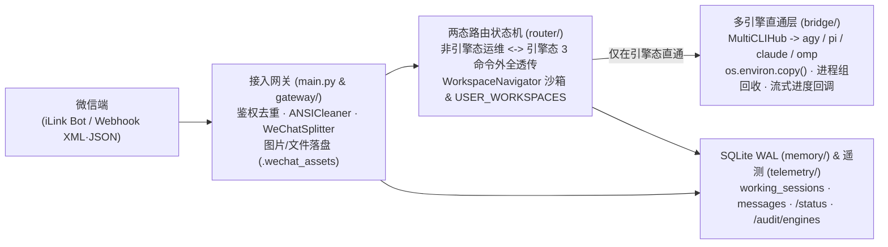

# agyWechat

[简体中文](README.md) | [English](docs/README_EN.md) | [架构说明](docs/ARCHITECTURE.md)


-003B57?logo=sqlite&logoColor=white)


**agyWechat** 是一个面向移动端随身编程的极简微信网关，直接无损桥接宿主机本地的四大原生 AI CLI：**Google Antigravity (`agy`)**、**Pi (`pi`)**、**Claude Code (`claude`)**、**Oh-My-Pi (`omp`)**。

> **开发初衷**：方便用户直接在移动端通过微信安全切换工作目录、查看宿主机状态，并携带完整本地环境直驱原生 AI 编程智能体进行真实工程开发。

---

## 核心特性与两态设计

网关严格遵守**两态分离（Two-State Separation）**，消除无效中间层拦截与误触发：
- **状态一 · 非引擎路由态（`active_engine == ""`）**：**严禁语音触发 AI**，仅响应文本运维/导航/导出指令；支持图片与文件片段直接落盘至当前绑定工作区。
- **状态二 · 引擎原生自治态（`active_engine in {"agy","pi","claude","omp"}`）**：网关**仅拦截 `/exit`、`/clear`、`/help`**，其余所有文本、微信原生语音 `Recognition`、任意其他 `/斜杠命令`及图文说明 **100% 携带宿主机完整 `os.environ` 直通 CLI 子进程**。

已验证核心能力：
- **双通道微信接入**：支持个人微信腾讯 iLink Bot（免公网扫码长轮询 + `ContextTokenStore` + `-14/-2` 过期自动重连）与标准 Webhook（`XML` / `<?xml...?>` / `JSON` + SHA-1 / `X-WeChat-Token` 鉴权）。
- **流式阶段进度摘要**：设置 `PROGRESS_PUSH_INTERVAL_SECONDS > 0` 后，超长任务期间按时间窗口推送 ANSI 清洗后的最新进展摘要（`⏳ [ENGINE 运行中 · Xs]`）。
- **附件安全落盘与联动**：微信图片与文件片段自动消毒文件名并落盘至 `<workspace>/.wechat_assets/`；在引擎态下附带 `caption` 时自动转交当前引擎分析。
- **多用户隔离与审计导出**：通过 `USER_WORKSPACES` 为不同用户分配独立并发默认工作区；支持 `/export [引擎]`、`/engines audit [引擎]` 与 `GET /audit/engines` 导出精细化指令调用 JSON。
- **终端清洗与持久化**：`ANSICleaner` + `WeChatSplitter`（跨分片保留 Markdown 代码块围栏）；SQLite WAL 仅维护 `working_sessions` 与 `messages` 双表并自动清理废表。

---

## 架构概览



```text
agyWechat/
├── main.py              # FastAPI 入口 (/, /health, /wechat/webhook, /audit/engines, flock 单实例锁)
├── config.py / .yaml    # 配置中心 (.env > config.yaml > Settings 默认值)
├── gateway/             # WeChatGateway、iLink 客户端与长轮询工人、ANSICleaner & WeChatSplitter
├── router/              # DeterministicRouter、EngineSessionRouter、WorkspaceNavigator
├── bridge/              # MultiCLIHub 与四引擎驱动 (agy / pi / claude / omp)
├── memory/ & telemetry/ # 双表 SQLite WAL 存储、审计导出与宿主机硬件遥测
├── scripts/             # login_wechat.py (iLink 扫码绑定) & wsl_service.sh (守护管理)
└── docs/ & tests/       # 架构详解 (ARCHITECTURE.md) 与 Pytest 测试套件
```

---

## 快速启动与配置

```bash
# 1. 克隆并安装依赖 (需 Python 3.10+、SQLite 3.35+ 及至少一个原生 CLI 引擎)
git clone https://github.com/MartinWZX/agyWechat.git && cd agyWechat
python3 -m venv venv && ./venv/bin/pip install -r requirements.txt
cp .env.example .env   # 编辑 ALLOWED_USERS 等关键配置

# 2. （可选）个人微信 iLink Bot 扫码登录（自动写入 WEIXIN_TOKEN 等凭证至 .env）
./venv/bin/python scripts/login_wechat.py

# 3. 启动与验证
./run.sh                             # 前台启动（或 bash scripts/wsl_service.sh start 后台托管）
curl -s http://127.0.0.1:8000/health # 健康检查
./venv/bin/pytest -v                 # 运行全量自动化测试
```

### 核心环境变量（`.env`）

| 变量名 | 默认值 | 说明 |
| :--- | :--- | :--- |
| `ALLOWED_USERS` | `["*"]` | **生产必改**：允许访问网关的微信用户 ID 列表（JSON 数组或逗号分隔） |
| `WORKSPACE_ROOT` | 当前目录 | 全局默认工作区根目录 |
| `USER_WORKSPACES` | `{}` | 多用户独立默认工作区映射（如 `{"u1":"/path/a","u2":"/path/b"}`） |
| `PROGRESS_PUSH_INTERVAL_SECONDS` | `0` | 流式中间态进度推送间隔秒数（`0` 关闭，正数按窗口推送） |
| `WECHAT_MAX_MSG_LEN` | `2000` | 单条回传微信消息最大字符数（自动代码块分段） |
| `AGY_BINARY` / `PI_BINARY` / `CLAUDE_BINARY` / `OMP_BINARY` | `agy` 等 | 显式覆盖四引擎二进制路径（未设时自动扫描 `PATH` 与 `~/.local/bin` 等） |
| `WEIXIN_TOKEN` / `WEIXIN_ACCOUNT_ID` | `None` | iLink Bot 凭证（非空时服务启动自动拉起长轮询；扫码脚本自动写入） |
| `WECHAT_TOKEN` / `WEBHOOK_REQUIRE_SIGNATURE` | `dev_token_123456` / `false` | Webhook 校验令牌（SHA-1 或 `X-WeChat-Token`）；公网暴露请改为随机强密码并设为 `true` |
| `WECHAT_PUSH_URL` / `WECHAT_BOT_SECRET` | `.../mock/wechat/push` / `""` | Webhook 主动推送回调地址与 `X-Bot-Secret` 密钥 |

---

## 微信端全量命令手册

### 1. 非引擎路由态（`active_engine == ""`，外层禁语音）

| 命令 / 输入 | 参数 | 实际效果 |
| :--- | :--- | :--- |
| `/help` | 无 | 查看可用文本命令与引擎入口 |
| `/status` | 无 | 宿主机 CPU 负载、内存、磁盘、运行时长与四引擎调用统计 |
| `/engines` | 无 | 并发探测四引擎安装状态、版本号、二进制路径与会话状态 |
| `/export` \| `/engines audit` | `[agy\|pi\|claude\|omp]` | 统计并导出每引擎指令调用明细至 `<workspace>/.wechat_audit/` |
| `/pwd` | 无 | 显示当前工作目录与项目标识（`.git`、`pyproject.toml` 等） |
| `/workspace` | `[路径]` | 校验沙箱安全边界（拦截 `/etc`、`.ssh`、`.aws`、`.config/gcloud` 等）并切换目录 |
| `/ls` | `[子目录]` | 列出目录前 25 项（跳过 `.git`、`node_modules`、`__pycache__`） |
| `/agy` \| `/pi` \| `/claude` \| `/omp` | **严禁带参数** | 校验二进制后进入对应引擎原生会话并返回欢迎面板 |
| **图片 / 文件片段** | 图片或文本内容 | 自动消毒文件名并落盘至 `<workspace>/.wechat_assets/`（不触发 AI） |

### 2. 引擎原生自治态（`active_engine in {"agy","pi","claude","omp"}`）

| 命令 / 输入 | 说明 |
| :--- | :--- |
| `/exit` | 退出当前引擎，退回非引擎路由态（保留当前工作目录） |
| `/clear` | 清空网关记录的 `conversation_id` 与轮次，下轮开启全新原生会话 |
| `/help` | 显示当前引擎版本、绑定目录、`conversation_id` 与这 3 个控制命令 |
| **其余一切文本 / 语音 / 斜杠命令 / 带说明附件** | **100% 直通当前原生 CLI**：语音直取微信 `Recognition`（为空直接报错），带 `caption` 附件先落盘再将路径与说明传给 CLI，输出与 `stderr` 经 ANSI 清洗原样回传 |

---

## 常见排障与开源协议

- **外层发语音被拒绝**：先发送 `/agy`（或 `/pi`、`/claude`、`/omp`）进入引擎后再发语音；进入后若提示“未获取到原生语音解析结果”，请检查手机微信语音转文字功能。
- **提示未检测到某 CLI**：宿主机执行 `which <engine>` 确认安装，或在 `.env` 中显式设置 `<ENGINE>_BINARY`。
- **服务日志与启停**：守护运行日志位于 `logs/agy_wechat_service.log`，使用 `bash scripts/wsl_service.sh {start|stop|restart|status}` 管理。
- **安全免责 & 协议**：进入引擎后 CLI 默认继承宿主机完整环境与配置文件中的跳过确认参数，请务必在 `.env` 配置 `ALLOWED_USERS` 白名单。本项目基于 **[MIT License](LICENSE)** 开源。
