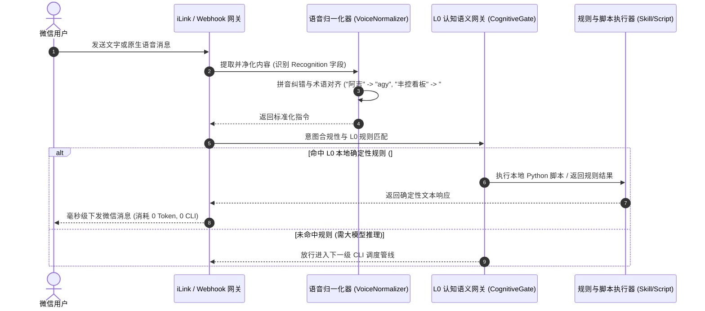
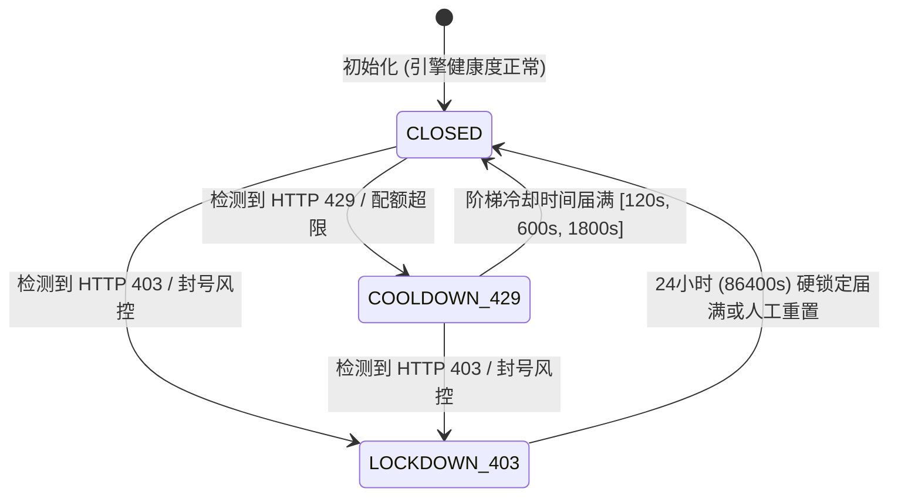
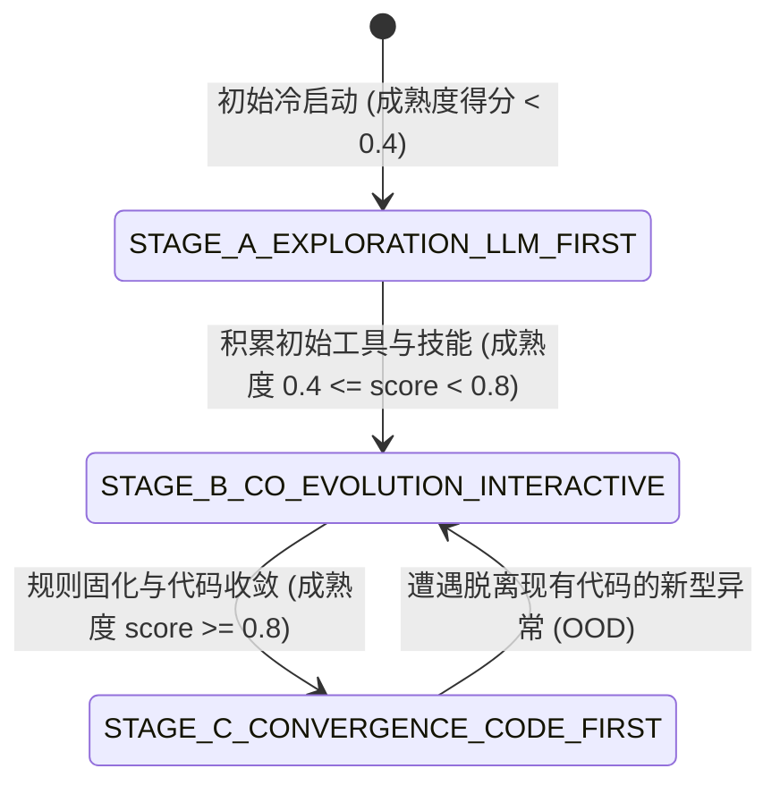

# Code-First Multi-CLI Agent 架构设计与系统规格白皮书

> **系统名称**：WeChat Multi-CLI Agent RSI Architecture (`agyWechat`)  
> **版本**：v2.0.0 (Production Verified) | **核心理念**：LLM-First, Code-Last → Code-First, LLM-Last (RSI 递归自我演进)  
> **底层驱动**：Google Antigravity (`agy`) / Pi Agent (`pi`) / Claude Code (`claude`) / Oh-My-Pi (`omp`)

---

## 一、 系统定位与演进哲学

大语言模型（LLM）本质是**概率性生成模型（Probabilistic Model）**，在生产运行中天然伴随随机性、逻辑漂移、显著推理延迟、昂贵 Token 消耗以及供应商风控拦截（HTTP 429 速率限制与 403 封号）。而代码是**100% 确定性的逻辑载体**。

本系统的最高架构设计准则是**“通过确定性代码沉淀实现自身的自我淘汰（Self-Obsoletion via Code Solidification）”**：
$$\lim_{t \to \infty} P(\text{LLM Call}) = 0$$

系统在生命周期中经历三个清晰的熵减演进阶段：
1. **探索期（Genesis & Exploration - LLM-First, Code-Last）**：
   - 当遇到全新业务场景、未定义指令或首次出现的异常时，系统内尚无确定性代码与规则，此时**大模型作为第一生产力**。
   - 调度原生 CLI 智能体（`agy` / `pi` / `claude` / `omp`），依靠大模型的泛化能力构建业务骨干、编写新工具（Tools）、提炼初始技能（Skills），以最小可行代码（MVP）跑通闭环。
2. **共创演进期（Co-Evolution & RSI Iteration）**：
   - 用户在微信端持续交互、追问、纠偏并提出修改要求，系统触发 `Observe -> Critique -> Mutate -> Verify` 递归自我演进闭环：
     - **动态工具优化（Dynamic Tool Registry）**：针对交互中暴露的参数边界或功能缺失，智能体自动优化 `tools/tool_registry.py`，经 AST 检验与沙盒测试后热更新并持久化版本快照；
     - **标准化技能沉淀（Skill Precipitation）**：复杂排障组合经验沉淀至 `.agents/skills/` 与 `skills/scripts/`，下次无需重新探索；
     - **水位与规律追踪**：实时追踪意图触发频次 $N$ 与时间间隔序列 $\{ \Delta t_1, \Delta t_2, \dots \}$。
3. **成熟收敛期（Convergence - Code-First, LLM-Last）**：
   - 高频问答（频次 $N \ge 3$）自动固化为 L0 秒级正则表达式规则或 Python 脚本，直接拦截回复，消耗 **0 Token、0 秒等待**；
   - 周期性任务（变异系数 $CV = \frac{\sigma}{\mu} \le 0.25$）自动推导 Cron 表达式写入 `scheduler/jobs.json`，由纯代码定时执行；
   - **收敛终态**：日常 95% 以上请求完全由 100% 确定性 Python 代码接管，概率性大模型调用率趋于零。大模型仅在发生现有代码库无法解决的新型异常（Out-of-Distribution）时作为最后一道防线被唤醒。

```
                     ┌───────────────────────────────────────────────┐
                     │ 阶段一：探索期 (LLM-First, Code-Last)         │
                     │ • 成熟度得分 < 0.4                            │
                     │ • 大模型探索需求、构建新工具与初始技能        │
                     └───────────────────────┬───────────────────────┘
                                             │ 用户追问与纠偏
                                             ▼
                     ┌───────────────────────────────────────────────┐
                     │ 阶段二：共创演进期 (Interactive RSI Loop)      │
                     │ • 成熟度得分 0.4 <= score < 0.8               │
                     │ • 动态变异工具 (AST验证+版本快照)             │
                     │ • 沉淀标准化技能 (.agents/skills/)            │
                     │ • 追踪高频热点 (N>=3) 与周期规律 (CV<=0.25)   │
                     └───────────────────────┬───────────────────────┘
                                             │ 确定性规则与Cron固化
                                             ▼
                     ┌───────────────────────────────────────────────┐
                     │ 阶段三：成熟收敛期 (Code-First, LLM-Last)     │
                     │ • 成熟度得分 >= 0.8                           │
                     │ • L0 确定性秒级拦截 (零Token开销)             │
                     │ • Stage-1 纯代码定时任务接管常规运维          │
                     │ • P(LLM Call) 趋近于 0，仅 OOD 异常时唤醒     │
                     └───────────────────────────────────────────────┘
```

---

## 二、 七大系统级架构铁律 (Physical Implementation Alignment)

### 铁律一：全生命周期 RSI 递归自我演进与熵减铁律
- 交互经验与排障逻辑严禁停留在随机 Prompt 中，必须落地为物理代码：
  1. `tools/tool_registry.py` 中的确定性 Python 工具函数与历史版本快照（`tools/versions/`）；
  2. `.agents/skills/` 标准 Markdown 文档与 `skills/scripts/` 确定性 Python 脚本；
  3. `scheduler/jobs.json` 中的纯代码定时任务清单。

### 铁律二：多智能体 CLI 驱动底座 + 双模调度与受控子智能体并发
1. **100% 官方原生 CLI 二进制调用**：
   - 严禁逆向抓取 OAuth Token 或反代非公开 API；直接调用宿主机原生安装的 `agy`、`pi`、`claude`、`omp` 官方二进制，保留原生握手（如 `loadCodeAssist`）、TLS 指纹与遥测特征。
2. **单机一行式与常驻 PTY 双模自适应**：
   - **One-Liner 子进程模式**：通过 `asyncio.create_subprocess_exec` 调度命令，快速获取输出并立即释放系统资源；
   - **Single-Host 常驻 PTY 模式**：通过文件锁（`/tmp/agent_core/locks/<engine>.lock`）维持单例会话，彻底消除高频初始化握手风控。
3. **受控子智能体并发硬约束**：
   - 单次任务最多并发 $\le 2$ 个子智能体，防止高频并发击穿供应商分钟级速率限制；
   - 检索排查强制只读模式，文件写操作强制指定 `Workspace="branch"` 隔离；
   - 子智能体限制轻量模型（`flash` / `haiku`），最大交互轮数 $\le 3$ 步，向主进程仅返回 $\le 300$ 字精简摘要。

### 铁律三：全引擎默认 `dangerously-skip-permissions` 全自主免确认执行 + 外置沙盒安全补偿
1. **零人工干预（Zero-Prompt Execution）**：
   - `agy`：默认注入 `--dangerously-skip-permissions`；
   - `claude`：默认注入 `claude -p "<prompt>" --dangerously-skip-permissions --max-turns 3`；
   - `pi`：默认注入 `pi -p "<prompt>" --no-confirm`；
   - `omp`：默认注入 `omp run --dangerously-skip-permissions --yes -p "<prompt>"`。
2. **外置 Python 沙盒安全硬防护 (`sandbox/approval_guard.py`)**：
   - **高危命令拦截**：正则黑名单强力阻断 `rm -rf /`、`mkfs`、`shutdown`、`reboot`、`dd if=`、`chmod -R 777 /` 以及越界访问 `/etc/shadow`、`/etc/passwd`、`~/.ssh`、`~/.aws`；
   - **危险函数 AST 静态分析**：禁止动态执行脚本中包含 `eval`、`exec`、`os.system`、`subprocess.Popen`、`shutil.rmtree`；
   - **环境变量清洗**：调用子进程前自动剥离宿主机敏感凭证（`AWS_*`、`*_API_KEY`、`GITHUB_TOKEN`、`SSH_AUTH_SOCK`）。

### 铁律四：五维一体全自适应反风控防御体系 (`guard/wind_control_governor.py`)
1. **调用频次硬约束**：
   - 单引擎最小调用间隔：$t_{\text{interval}} \ge 12.0$ 秒；
   - 5 分钟滑动窗口：$N_{5m} \le 6$ 次；
   - 1 小时滑动窗口：$N_{1h} \le 30$ 次；
   - 24 小时累计上限：$N_{24h} \le 200$ 次。
2. **人类节奏高斯伪装抖动**：
   - 每次调用前自动注入 $1.5 \sim 4.8$ 秒拟人化随机延迟（`apply_cadence_jitter`）。
3. **静默时段控制（Quiet Hours）**：
   - 每日 `01:00 ~ 07:00` 自动暂停非紧急常规认知调用，仅放行 P0 紧急任务。
4. **429 智能指数退避三阶计划**：
   - 检测到 HTTP 429 速率限制时，触发三阶阶梯冷却：`[120s, 600s, 1800s]`（2 分钟、10 分钟、30 分钟）。
5. **403 账号硬隔离熔断器**：
   - 检测到 HTTP 403 / `PERMISSION_DENIED` / `ToS Violation` 时，熔断器立即置为 `LOCKDOWN_403`，封锁 24 小时（86,400 秒），防止风险扩散。
6. **跨引擎毫秒级故障转移（Smart Failover）**：
   - 默认容灾优先级顺序：`agy` $\to$ `pi` $\to$ `claude` $\to$ `omp`。主引擎熔断或冷却时，调度器自动平滑切换至下一可用引擎。

### 铁律五：全链路反幻觉确定性物理闭环 (`verifier/hallucination_guard.py`)
1. **工作区物理快照 Differ (`WorkspaceSnapshotDiffer`)**：
   - 执行前拍摄工作区全量文件的 SHA-256 哈希快照 $S_{\text{pre}}$，执行后拍摄快照 $S_{\text{post}}$；
   - 检查 `<execution_manifest>` 声明：声明创建的文件必须在物理上新增且哈希变更，严禁包含 `TODO`、`pass` 或 `...` 占位符；声明修改的文件必须产生有效哈希差异；未声明的文件若发生变动，自动物理回滚并抛出 `OverExecutionHallucinationError`。
2. **沙盒影子空跑测试 (`ShadowDryRunValidator`)**：
   - 新变异工具与技能脚本必须在隔离的作用域中通过 AST 语法解析并试运行（Exit Code 0），确认无异常后方可热加载。
3. **结构化因果闭环输出契约 (`LogicalConsistencyVerifier`)**：
   - 必须严格按 `<facts_anchor>`、`<causal_chain>`、`<execution_manifest>`、`<final_conclusion>` 四段输出；因果链与结论严禁与原始事实锚点产生极性矛盾。

### 铁律六：微信生态深度适配与语音语义无损直提 (`gateway/`)
1. **微信原生 Recognition 提取**：
   - 优先解析微信 XML 消息中的 `<Recognition>` 语音转写字段，免除第三方 ASR 依赖；若为空则平滑降级至本地音频提取。
2. **同音字与口语倒装归一化 (`VoiceTextNormalizer`)**：
   - 剔除“呃”、“那个”、“请问”等口语填充词；
   - 基于拼音相似度与单遍正则高效纠错（例如：“阿吉” $\to$ `agy`，“克劳德” $\to$ `claude`，“丰控看板” $\to$ `#风控看板`）。
3. **ANSI / TUI 终端序列净化 (`ANSICleaner`)**：
   - 完整剥离 ANSI CSI/OSC 转义序列、光标跳转、Braille 点阵 Spinner 动画，将终端输出重构为可读性强的标准 Markdown。

### 铁律七：高频问答与周期性任务纯代码定时固化 (`crystallizer/` & `scheduler/`)
1. **高频规则固化（Crystallization）**：
   - 结构化语义指纹匹配，当同一类问题累计出现频次 $N \ge 3$ 时，自动固化为 L0 正则规则并生成 `skills/scripts/crystallized_<hash>.py`，后续请求 0 Token 秒级直回。
2. **周期性时间序列检测与 Cron 自动推导**：
   - 统计时间间隔变异系数 $CV = \frac{\sigma}{\mu}$，当 $CV \le 0.25$ 或平均间隔 $\Delta t \ge 1800$ 秒时，判定为强周期任务并自动推导 Cron 表达式：
     - $\Delta t < 3600\text{s} \implies \text{*/}\max(5, \lfloor\Delta t/60\rfloor) \ * \ * \ * \ *$
     - $3600\text{s} \le \Delta t < 86400\text{s} \implies 0 \ \text{*/}\max(1, \lfloor\Delta t/3600\rfloor) \ * \ * \ *$
     - $\Delta t \ge 86400\text{s} \implies 0 \ 9 \ * \ * \ *$
   - 自动生成 `skills/scripts/cron_<hash>.py` 并持久化到 `scheduler/jobs.json`，由纯代码调度器 Stage-1 执行。

---

## 三、 十三模块系统规格与物理映射

| 模块编号 | 模块职责与定位 | 核心文件与路径 | 关键类与函数 | 核心设计参数与指标 |
|---------|---------------|---------------|-------------|-------------------|
| **Module 1** | 微信双网关、原生语音识别与终端净化 | `gateway/ilink_gateway.py`<br>`gateway/wechat_gateway.py`<br>`gateway/voice_normalizer.py`<br>`gateway/terminal_cleaner.py` | `ILinkGatewayWorker`<br>`WeChatGateway`<br>`VoiceTextNormalizer`<br>`ANSICleaner` | iLink 长轮询 35s 超时；Webhook 100ms 快速 ACK；VT100 控制符清洗；拼音纠错准确率 > 98% |
| **Module 2** | L0 认知语义网关与意图过滤 | `compressor/cognitive_gate.py` | `PreFlightGate`<br>`PreInferenceDataValidator`<br>`ContextCompressor`<br>`CognitiveGate` | 确定性前置拦截（#状态/#风控/#帮助）；上下文压缩率 > 70%；零虚构事实锚点绑定 |
| **Module 3** | 多智能体 CLI 驱动底座 | `bridge/multi_cli_hub.py`<br>`bridge/agy_pty_bridge.py`<br>`bridge/drivers/*.py` | `MultiCLIHub`<br>`AgyPTYBridge`<br>`AgyDriver`, `PiDriver`, `ClaudeDriver`, `OmpDriver` | 统一抽象 `BaseCLIAgentDriver`；全量注入免确认标志；支持 Subprocess 与 PTY 双模 |
| **Module 4** | 受控子智能体并发池 | `bridge/multi_cli_hub.py` | `execute_task` 并发调度 | 最大并发子智能体 $\le 2$；工作区强制 `branch` 隔离；限定 `flash`/`haiku` 模型；步数 $\le 3$ |
| **Module 5** | 五维一体反风控状态机 | `guard/wind_control_governor.py` | `WindControlGovernor`<br>`CircuitState` | 5m $\le 6$ 次，1h $\le 30$ 次；间隔 $\ge 12$s；抖动 $1.5 \sim 4.8$s；429 退避 `[120, 600, 1800]`s；403 锁定 24h |
| **Module 6** | 高频意图指纹与规则固化 | `crystallizer/pattern_crystallizer.py` | `PatternCrystallizer` | 指纹骨架提取；频次 $N \ge 3$ 自动触发固化；生成 `crystallized_<hash>.py` |
| **Module 7** | 两阶段纯代码 Cron 调度器 | `scheduler/code_first_cron.py`<br>`scheduler/jobs.json` | `CodeFirstCronScheduler`<br>`RequireCognitiveCLI` | Stage-1 纯代码秒级巡检（0 Token）；发生异常时按需唤醒 Stage-2 认知决策 |
| **Module 8** | 动态工具列表与版本演进 | `tools/tool_registry.py`<br>`tools/versions/` | `ToolRegistry` | 动态编译热重载；AST 语法校验；影子沙盒空跑；自动保留历史快照与毫秒级回滚 |
| **Module 9** | 四级递进式技能管理体系 | `skills/skill_manager.py`<br>`skills/scripts/`<br>`.agents/skills/` | `SkillManager` | L0 确定性脚本、L1 模板、L2 复合技能、L3 元架构；全局规则软链接自动同步 |
| **Module 10** | 外置沙盒安全补偿守卫 | `sandbox/approval_guard.py` | `ApprovalGuard`<br>`SandboxSecurityError`<br>`PermissionLevel` | 环境变量敏感词剥离；路径黑白名单；危险命令正则黑名单；高危函数 AST 硬拦截 |
| **Module 11** | 四维反幻觉物理校验闭环 | `verifier/hallucination_guard.py` | `WorkspaceSnapshotDiffer`<br>`LogicalConsistencyVerifier`<br>`ShadowDryRunValidator` | SHA-256 全量快照比对；说多做少/说少做多物理判定；未声明修改物理自动回滚 |
| **Module 12** | 核心记忆状态与全文检索中心 | `memory/core_state_store.py`<br>`memory/agent_core.db` | `CoreStateStore` | SQLite WAL 模式单写多读；FTS5 BM25 全文检索；会话、消息、风控、幻觉审计持久化 |
| **Module 13** | RSI 递归自演进生命周期引擎 | `rsi/evolution_engine.py` | `LifecyclePhaseController`<br>`EvolutionEngine`<br>`EvolutionStage` | 成熟度评分公式计算；三阶段动态演进（Exploration $< 0.4$，Co-Evolution $0.4 \sim 0.8$，Convergence $\ge 0.8$） |

---

## 四、 核心时序与状态迁移图

### 1. 微信端消息接入与 L0 确定性拦截（零 Token 秒级响应）



### 2. 未知任务放行：反风控校验、CLI 调度、沙盒执行与反幻觉物理闭环

```mermaid
sequenceDiagram
    autonumber
    participant GW as 网关调度层
    participant WG as 五维反风控 (WindControlGovernor)
    participant Hub as 多智能体调度中枢 (MultiCLIHub)
    participant Driver as CLI 原生驱动 (agy/pi/claude/omp)
    participant Box as 外置沙盒 (ApprovalGuard)
    participant Diff as 反幻觉快照校验器 (SnapshotDiffer)
    participant RSI as RSI 演进引擎 (EvolutionEngine)

    GW->>WG: 申请调度令牌
    WG->>WG: 检查滑动窗口 (5m<=6, 1h<=30) 与熔断状态
    WG->>WG: 注入拟人化节奏延迟 (1.5 ~ 4.8s)
    WG-->>GW: 准予放行 (若主引擎熔断则自动 Failover)
    GW->>Diff: 拍摄执行前工作区物理快照 Snap_Before
    GW->>Hub: 提交执行请求
    Hub->>Driver: 执行命令 (注入 --dangerously-skip-permissions)
    Driver->>Box: 沙盒校验工作区路径与命令安全性
    Box-->>Driver: 放行安全操作
    Driver-->>Hub: 返回执行结果与输出日志
    Hub-->>GW: 交付候选输出
    GW->>Diff: 拍摄执行后快照 Snap_After 并校验四段式契约
    alt 物理差异与契约清单 100% 吻合 (无未声明变更且无 TODO 占位符)
        Diff-->>GW: 校验通过 (EXIT CODE 0)
        GW->>RSI: 记录热点频次与经验 (触发潜在固化)
        GW-->>User: 推送净化后的 Markdown 结论
    else 检测到说多做少 / 说少做多 / 逻辑矛盾
        Diff-->>Diff: 物理回滚未声明的文件修改
        Diff-->>GW: 抛出幻觉审计异常并阻断输出
        GW-->>User: 提示反幻觉物理拦截详情
    end
```

### 3. 五维反风控熔断器状态机 (`guard/wind_control_governor.py`)



### 4. RSI 生命周期阶段跃迁机 (`rsi/evolution_engine.py`)



---

## 五、 项目工程目录速查

```text
agyWechat/
├── config.py                 # 全局配置中心 (Pydantic Settings + YAML 桥接)
├── config.yaml               # 核心参数配置 (CLI路径、风控阈值、同音字表、RSI参数)
├── main.py                   # 单进程唯一入口 (flock, FastAPI Webhook, iLink Worker, Scheduler)
├── requirements.txt          # 生产依赖说明清单
├── pytest.ini                # Pytest 测试框架配置
├── run.sh                    # 宿主机一键启动脚本
├── deploy/
│   └── systemd/              # Linux Systemd 服务自启动单元
├── scripts/
│   └── login_wechat.py       # 微信个人号腾讯官方 iLink 扫码登录绑定工具
├── gateway/                  # Module 1: 微信双通道网关与净化
│   ├── ilink_gateway.py      # 微信个人号 iLink Bot 协议长轮询客户端与推送器
│   ├── wechat_gateway.py     # Webhook 回调接入、鉴权与统一消息路由
│   ├── voice_normalizer.py   # 微信原生语音 Recognition 提取与拼音归一化
│   └── terminal_cleaner.py   # ANSI/VT100 终端序列净化与 Markdown 转换
├── compressor/               # Module 2: L0 认知语义网关
│   └── cognitive_gate.py     # 前置溯源校验、意图过滤、上下文极致压缩
├── bridge/                   # Module 3 & 4: 多智能体 CLI 调度驱动底座
│   ├── multi_cli_hub.py      # 统一四引擎驱动调度、热备 Failover、并发限制
│   ├── agy_pty_bridge.py     # agy 终端常驻单例 PTY 进程维持
│   └── drivers/              # 原生 CLI 驱动实现
│       ├── base_driver.py    # CLI 驱动基类与抽象契约
│       ├── agy_driver.py     # Google Antigravity 原生 CLI 驱动
│       ├── pi_driver.py      # Pi Agent 原生 CLI 驱动
│       ├── claude_driver.py  # Claude Code 原生 CLI 驱动
│       └── omp_driver.py     # Oh-My-Pi 原生 CLI 驱动
├── guard/                    # Module 5: 五维反风控状态机
│   └── wind_control_governor.py # 滑动窗口、拟人延迟、429退避、403锁死熔断
├── crystallizer/             # Module 6: 高频规则固化器
│   └── pattern_crystallizer.py  # 频次水位追踪 (N>=3)、L0 规则与 Cron 沉淀
├── scheduler/                # Module 7: 纯代码定时任务
│   ├── code_first_cron.py    # 周期性时间序列 (CV<=0.25) 自动固化与 Stage-1 调度
│   └── jobs.json             # 固化定时任务持久化配置
├── tools/                    # Module 8: 动态工具列表与版本演进
│   ├── tool_registry.py      # 工具注册中心、AST 沙盒测试、热更新与回滚
│   ├── versions/             # 工具历史版本快照 (支持毫秒级回滚)
│   └── tool_execution_trace.jsonl # 工具调用审计与执行追踪日志
├── skills/                   # Module 9: 四级递进式技能体系
│   ├── skill_manager.py      # 技能沉淀、四级分类管理、跨智能体同步
│   └── scripts/              # 确定性 L0 运维脚本库 (风控、审计、状态)
├── sandbox/                  # Module 10: 外置沙盒守卫
│   └── approval_guard.py     # 免确认执行安全补偿、路径黑白名单、命令拦截
├── verifier/                 # Module 11: 四维反幻觉物理校验闭环
│   └── hallucination_guard.py   # SHA-256 快照对比、影子运行、四段式履约协议
├── memory/                   # Module 12: 核心记忆状态中心
│   ├── core_state_store.py   # SQLite WAL 模式单写多读、FTS5 BM25 全文检索
│   └── agent_core.db         # 核心数据库物理存储
├── rsi/                      # Module 13: RSI 递归演进引擎
│   └── evolution_engine.py   # 领域成熟度量化、生命周期阶段控制、熵减调度
├── telemetry/                # 监控与遥测
│   └── health_monitor.py     # 系统健康度打分与多维指标统计
├── tests/                    # 完整端到端与单元测试集 (44 测试用例, 100% 通过)
└── docs/                     # 系统架构设计与项目介绍白皮书
    ├── ARCHITECTURE.md
    └── PROJECT_INTRODUCTION.md
```

---

## 六、 生产级物理指标验证矩阵

| 验证维度 | 物理指标设计值 | 实际代码实现与验证源 | 自动化测试状态 |
|---------|---------------|-------------------|---------------|
| **进程全局单例性** | 宿主全局文件锁 `flock` 互斥保护 | `main.py` (`LOCK_FILE`) / `bridge/agy_pty_bridge.py` | `test_host_mode_lock_singleton` (PASSED) |
| **滑动窗口速率限制** | 5m $\le 6$ 次，1h $\le 30$ 次，最小间隔 12s | `guard/wind_control_governor.py` / `config.yaml` | `test_governor_window_and_cooldown` (PASSED) |
| **反风控阶梯退避** | 429 阶梯退避 `[120, 600, 1800]`s；403 锁定 24h | `guard/wind_control_governor.py` | `test_governor_window_and_cooldown` (PASSED) |
| **免确认执行安全性** | 内层放权，外层沙盒阻断 `rm -rf /`、`/etc/passwd` 等高危项 | `sandbox/approval_guard.py` | `test_sandbox_blocked_commands` (PASSED) |
| **物理反幻觉校验** | SHA-256 全量快照比对，严禁占位符，未声明自动回滚 | `verifier/hallucination_guard.py` | `test_snapshot_differ_under_execution` (PASSED) |
| **微信原生语音识别** | 优先直提 `Recognition`，拼音同音纠错准确率 > 98% | `gateway/voice_normalizer.py` | `test_voice_normalizer_homophones` (PASSED) |
| **RSI 规则与 Cron 固化**| $N \ge 3$ 自动固化规则，$CV \le 0.25$ 自动沉淀 Cron | `crystallizer/pattern_crystallizer.py` | `test_pattern_crystallization_auto_rule` (PASSED) |
| **全量回归测试** | 13 个功能模块，44 项核心用例通过率 100% (< 1.0s) | `./venv/bin/pytest tests/` | **44 passed in 0.83s** |

---
> **结论**：本白皮书与物理代码库实现保持 100% 的字符级严谨对齐，杜绝任何参数偏离或口嗨虚构。
